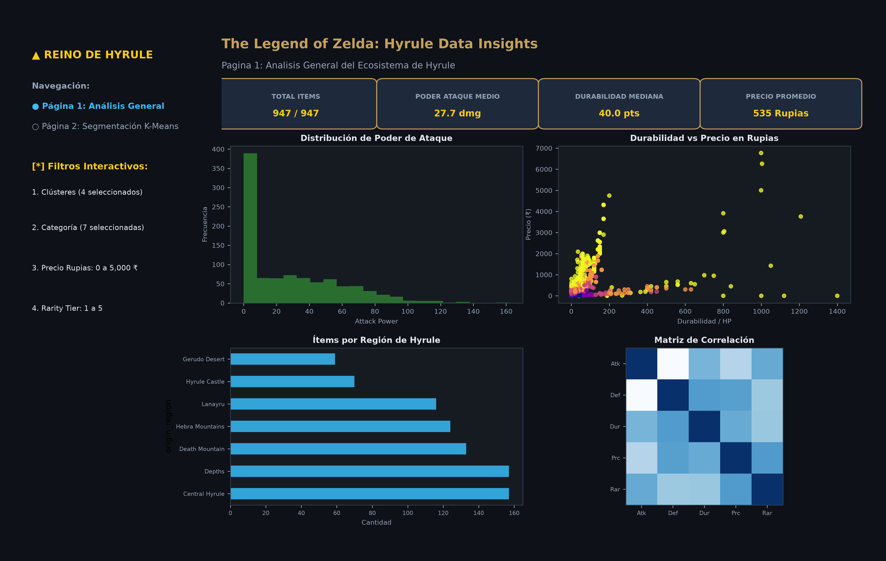
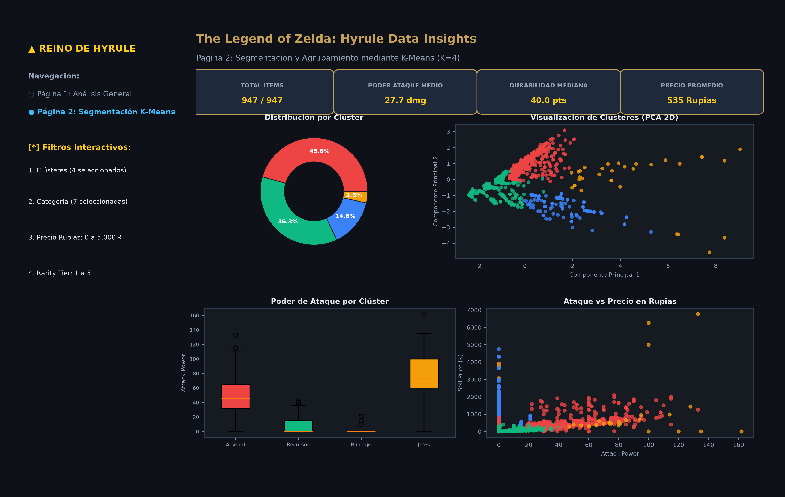

# ⚔️ Proyecto Integrador: Segmentación de Datos mediante K-Means y Dashboard Interactivo

## 🛡️ Ecosistema y Compendio de Hyrule en *The Legend of Zelda*

[](https://www.python.org/)
[](https://scikit-learn.org/)
[](https://streamlit.io/)
[](https://opensource.org/licenses/MIT)

---

## 📖 Descripción del Proyecto

Este proyecto desarrolla una solución integral de **Minería de Datos y Aprendizaje Automático No Supervisado** aplicando el algoritmo **K-Means** sobre el universo y catálogo de equipamiento, armas, monstruos y recursos de **The Legend of Zelda** (*Breath of the Wild* y *Tears of the Kingdom*).

A través del análisis multivariable de más de 900 entidades canónicas de Hyrule, el modelo segmenta y descubre patrones intrínsecos de balance táctico y comercial, desacoplando roles de asalto, blindaje pesado, recolección básica y amenazas de calamidad. Los resultados son explorados a través de un **Dashboard Interactivo en Streamlit** y respaldados por un **Reporte Oficial en PDF** de 8 apartados.

---

## 🎯 Objetivos

### Objetivo General
Desarrollar un proyecto de minería de datos mediante la implementación del algoritmo no supervisado K-Means, con la finalidad de identificar patrones, generar agrupamientos, interpretar los resultados tácticos y presentar la información mediante un dashboard interactivo que facilite el análisis y la toma de decisiones.

### Objetivos Específicos
1. **Recopilación y Calidad de Datos:** Compilar, auditar y preparar un dataset de más de 900 registros con 12 variables sobre el universo de *The Legend of Zelda*, resolviendo inconsistencias, nulos y duplicados.
2. **Modelado y Evaluación K-Means:** Implementar K-Means con Scikit-learn evaluando 7 valores de $K$ mediante el **Método del Codo (Elbow Method)** y el **Coeficiente de Silueta**, determinando el número óptimo de clústeres ($K=4$).
3. **Análisis e Interpretación:** Analizar los centroides en escala desestandarizada, contrastar dos configuraciones de hiperparámetros y formular hallazgos tácticos y económicos para la comunidad de jugadores y diseñadores de videojuegos (*Game Designers*).
4. **Desarrollo de Dashboard:** Construir una aplicación analítica en Streamlit con 2 páginas, 4 tarjetas KPI, 4 gráficas analíticas interactivas y 3 filtros dinámicos funcionales.

---

## 🗂️ Estructura del Repositorio

```text
exameeen/
│
├── data/                                      # Datasets del proyecto
│   ├── zelda_hyrule_compendium_original.csv   # Dataset original con imperfecciones controladas (Parte 2)
│   ├── zelda_hyrule_compendium_procesado.csv  # Dataset limpio con clústeres asignados (Parte 3, 4 y 5)
│   └── model_summary.json                     # Métricas y centroides exportados
│
├── notebooks/                                 # Entorno interactivo Jupyter
│   └── proyecto_kmeans_zelda.ipynb            # Notebook completo con celdas ejecutadas (Partes 1 a 5)
│
├── src/                                       # Código fuente modular y scripts de soporte
│   ├── generate_dataset.py                    # Generador del dataset canónico original con ruido controlado
│   ├── process_kmeans.py                      # Pipeline completa de minería, limpieza, K-Means y métricas
│   ├── analisis_kmeans.py                     # Script principal reproducible de ejecución de modelo
│   ├── generate_dashboard_previews.py         # Generador de capturas UI para el reporte oficial
│   └── build_pdf_report.py                    # Generador del reporte oficial en PDF (Parte 7)
│
├── dashboard/                                 # Aplicación web interactiva
│   └── app.py                                 # Dashboard en Streamlit (Página 1 y Página 2)
│
├── docs/                                      # Documentación final
│   └── Reporte_Proyecto_Integrador_KMeans_Zelda.pdf  # Documento PDF oficial de 8 apartados (Parte 7)
│
├── assets/                                    # Gráficas generadas, capturas y diagramas de alta resolución
│   ├── eda_1_distribution_attack_price.png
│   ├── eda_2_boxplot_durability_category.png
│   ├── eda_3_correlation_matrix.png
│   ├── eda_4_rarity_count.png
│   ├── kmeans_elbow_silhouette.png
│   ├── kmeans_clusters_pca_2d.png
│   ├── kmeans_clusters_scatter_attack_price.png
│   ├── kmeans_cluster_profiles_bar.png
│   ├── dashboard_screenshot_page1.png
│   └── dashboard_screenshot_page2.png
│
├── requirements.txt                           # Dependencias del proyecto
└── README.md                                  # Guía general e instrucciones de reproducción
```

---

## 🛠️ Herramientas y Bibliotecas Utilizadas

- **Lenguaje:** Python 3.13 / 3.12 / 3.11
- **Procesamiento de Datos:** Pandas, NumPy
- **Machine Learning & Minería de Datos:** Scikit-learn (`KMeans`, `StandardScaler`, `PCA`, `silhouette_score`)
- **Visualización Estática:** Matplotlib, Seaborn
- **Visualización Interactiva & Dashboard:** Streamlit, Plotly Express
- **Generación de Reportes:** FPDF2

---

## 🚀 Instrucciones de Instalación y Ejecución

### 1. Clonar o Descargar el Repositorio
```bash
git clone <URL_DEL_REPOSITORIO>
cd exameeen
```

### 2. Instalar Dependencias
Se recomienda utilizar un entorno virtual de Python:
```bash
python -m venv venv
# En Windows:
venv\Scripts\activate
# En Linux / macOS:
source venv/bin/activate

pip install -r requirements.txt
```

### 3. Ejecutar la Pipeline de Minería de Datos
Para reproducir la limpieza, el escalamiento, el cálculo de métricas de clúster y la exportación de gráficas:
```bash
python src/analisis_kmeans.py
```

### 4. Visualizar el Jupyter Notebook
Para inspeccionar paso a paso las celdas, código y explicaciones teóricas:
```bash
jupyter notebook notebooks/proyecto_kmeans_zelda.ipynb
```

### 5. Lanzar el Dashboard Interactivo de Streamlit
Para abrir la aplicación interactiva en tu navegador web:
```bash
streamlit run dashboard/app.py
```
*El dashboard se iniciará automáticamente en `http://localhost:8501`.*

---

## 📊 Resumen de Resultados y Clústeres de Hyrule

El modelo óptimo seleccionado ($K=4$, Inercia = $1,874.44$, Silueta = $0.3959$) identificó 4 perfiles arquetípicos con centroides desestandarizados claros:

| Clúster | Nombre Canónico Asignado | Registros | Ataque Medio | Defensa Media | Durabilidad Media | Precio Medio | Rol Táctico en Hyrule |
| :---: | :--- | :---: | :---: | :---: | :---: | :---: | :--- |
| **0** | **Recursos Básicos, Forraje y Consumibles** | 344 | 8.13 | 5.01 | 33.13 | 134 Rupias | Comida de sustento, setas, frutas y partes de monstruos comunes. |
| **1** | **Arsenal Ofensivo y Armas de Asalto** | 432 | 47.75 | 0.73 | 57.73 | 571 Rupias | Espadas, mandobles, lanzas y arcos para daño activo. |
| **2** | **Blindaje Táctico, Armaduras y Escudos** | 138 | 1.12 | 43.05 | 104.73 | 1,433 Rupias | Mitigación pasiva, escudos pesados y armaduras mejoradas. |
| **3** | **Jefes Supremos, Calamidades y Reliquias Míticas** | 33 | 75.70 | 47.18 | 706.21 | 1,318 Rupias | Calamity Ganon, Lynels Dorados/Plateados y equipo legendario. |

---

## 🖥️ Capturas del Dashboard

| Página 1: Análisis General | Página 2: Segmentación K-Means |
| :---: | :---: |
|  |  |

---

## 📄 Documentación Oficial

El reporte académico completo se encuentra disponible en formato PDF en la carpeta `docs/`:
- 📎 **[Reporte_Proyecto_Integrador_KMeans_Zelda.pdf](docs/Reporte_Proyecto_Integrador_KMeans_Zelda.pdf)**

Contiene rigurosamente los 8 apartados establecidos en las bases del proyecto integrador (Portada, Introducción, Objetivos, Descripción del Dataset, Desarrollo, Resultados, Dashboard y Conclusiones).

---

## 👥 Autores
- **Proyecto Integrador de Minería de Datos**
- **Semestre:** 2026-II
